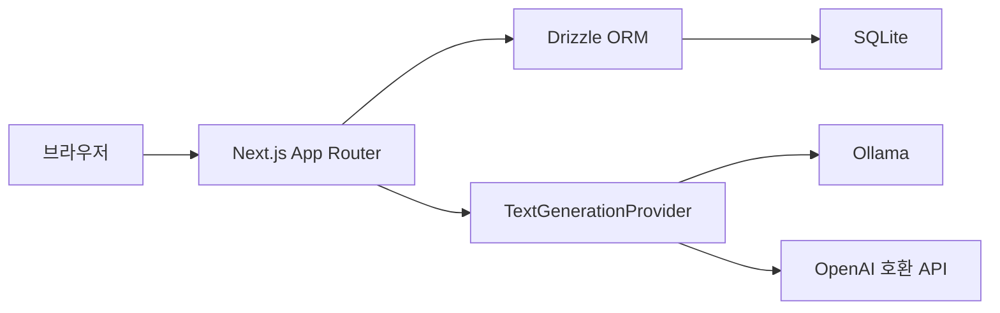

# 아키텍처

이 문서는 **현재 구현**만 설명한다. 목표 기능과 미구현 항목은
[제품 기준](./product.md)과 [로드맵](./roadmap.md)을 따른다.

## 구성

- Next.js 애플리케이션이 화면, Server Action, Route Handler를 함께 제공한다.
- Drizzle ORM의 libSQL client가 로컬 SQLite 파일 또는 원격 Turso libSQL DB를 읽고 쓴다.
- AI 생성은 공급자 중립 인터페이스를 통해 선택된 모델 API를 호출한다.
- 기존 standalone Docker 운영을 유지하며 원격 DB를 사용하는 Vercel 배포 설정도 지원한다. 실제 클라우드 배포와 외부 API 검증은 별도 단계다.

정확한 패키지와 버전은 [`package.json`](../package.json), 데이터 필드는
[`src/db/schema.ts`](../src/db/schema.ts)가 기준이다.

## 기술 스택

| 영역 | 선택 |
| --- | --- |
| 런타임과 패키지 관리 | Node.js, pnpm |
| 웹 애플리케이션 | Next.js App Router, React, TypeScript |
| 스타일링과 UI | Tailwind CSS, PostCSS, shadcn-ui, Lucide |
| 인증 및 인가 | better-auth (Google OAuth) |
| 환경변수 및 타입 검증 | Zod |
| 클라이언트 서버 상태 | TanStack Query |
| URL 상태 | nuqs |
| 데이터베이스 | SQLite(libSQL client), Drizzle ORM |
| 날짜 처리 | date-fns, KST 기준 유틸리티 |
| AI 연동 | Ollama 또는 OpenAI 호환 Chat Completions API |
| 품질 관리 | ESLint, TypeScript, Husky, lint-staged |
| 빌드와 운영 | Next.js standalone, Docker Compose, GitHub Actions |

이 표는 역할과 기술 선택만 설명한다. 설치 버전과 실행 명령은
[`package.json`](../package.json), 운영 환경은 [운영 가이드](./operations.md)를
따른다.

## 코드 경계

| 경로 | 책임 |
| --- | --- |
| `src/proxy.ts` | 쿠키가 없는 보호 화면 요청을 로그인으로 이동 (실제 권한 검사는 데이터 접근 시 수행) |
| `src/lib/auth.ts`, `src/lib/workspace-access.ts` | Google 세션과 공유 자료·AI 이용 권한을 별도 검사. 모든 업무 진입점에서 권한 확인 |
| `src/env.ts` | 인증·AI·DB별 지연 Zod 검증. 앱과 Drizzle Kit가 동일 DB 검증을 공유 |
| `src/app` | 라우트, 페이지 조합, Route Handler, 해당 화면 전용 Action/UI |
| `src/components` | 여러 라우트에서 재사용하는 UI |
| `src/features` | 도메인별 쿼리, 타입, 클라이언트 쿼리 키 |
| `src/db/index.ts` | 검증된 설정과 DB 어댑터의 조립 |
| `src/db/adapters/libsql.ts` | 로컬 SQLite/Turso용 libSQL 연결·실행 구현 |
| `src/db/schema.ts` | SQLite 데이터 모델과 추론 타입 |
| `src/app/api/generate-*` | 일일·주간 생성 요청과 HTTP 응답 처리 |
| `src/lib/ai.ts` | 기록 생성 use case와 공급자 호출 조합 |
| `src/lib/daily-record.ts` | Drizzle에서 도출한 초안 타입·검증과 AI 최종 응답 파서 |
| `src/lib/ai/provider.ts` | 환경설정에 따른 공급자 선택 |
| `src/lib/ai/providers` | 외부 모델 API별 어댑터 |
| `src/lib/ai/prompts.ts` | 공급자와 독립적인 기록 프롬프트 |
| `src/lib/dateUtils.ts` | 주간 범위와 KST 날짜 계산 |

App Router의 파일 규칙을 바꿀 때는 설치된 Next.js 문서
`node_modules/next/dist/docs/01-app/`를 먼저 확인한다.

## 주요 흐름

### 대상자 목록

1. `/` 서버 컴포넌트가 세션·workspace 자료 권한을 확인한 뒤 대상자 첫 페이지를 조회한다.
2. 클라이언트 목록이 API를 통해 다음 페이지를 무한 스크롤로 조회한다.
3. 대상자 등록은 Server Action으로 저장한 뒤 경로와 클라이언트 쿼리를 갱신한다.

### 일일 기록

1. `/recipients/[id]`가 대상자와 기간별 기록을 조회한다.
2. 사용자가 날짜와 관찰 메모를 입력한다.
3. `/api/generate-daily`가 선택된 AI 공급자의 응답을 동일한 텍스트 스트림으로
   변환한다.
4. 스트림 정상 종료 후 일반 생성과 같은 파서로 최종 형식을 검증한다. 빈 결과와 형식 오류는 초안에서 제거한다. 사용자가 수정한 결과도 저장 시 같은 스키마로 검증한다.
5. 관찰 근거가 없는 영역은 비워 둘 수 있으며, 최소 한 영역에 기록이 있어야 한다. 각 영역은 UI와 동일하게 최대 1,000자다.

### 주간 기록

1. 선택한 주의 일일 기록을 조회한다. 주간 폼의 React key를 대상자·주 시작일로 지정해 기간 전환 시 생성 ID·편집·모달 상태가 이전 주에서 이어지지 않도록 한다. 같은 주의 날짜 이동에서는 상태를 유지한다. 생성 성공 시 해당 대상자·주의 최초 조회 캐시를 무효화해 즉시 다른 주를 다녀와도 생성된 기록을 다시 찾는다.
2. `generateWeeklyReportBackground` Server Action이 `PROCESSING`을 저장하고, 해당 월요일부터 7일간의 일일 기록을 AI에 전달하는 Promise를 `after()`에 반환한다.
3. 클라이언트가 레코드 상태를 polling하고, 생성이 끝나면 `COMPLETED` 결과를
   표시한다.

## 시간 기준

사용자 날짜는 `YYYY-MM-DD` 문자열이며 화면의 “오늘”은 KST
(`Asia/Seoul`)를 기준으로 한다. 주간 범위는 월요일부터 일요일까지다.
시간대의 단일 기준은 `src/lib/dateUtils.ts`의 `RECORD_TIME_ZONE`이다. 현재 값은
`Asia/Seoul`이며 향후 기관 설정으로 교체한다. 현재 기관별 설정/UI는 없다.
기존 `getKSTDateStr`·`getWeekData` 인터페이스를 유지한다. 시각은 명시적으로 `Asia/Seoul` 날짜로 변환하고, 날짜 문자열의 주차·이동은 UTC 달력 필드로 계산해 서버/브라우저 시간대와 DST의 영향을 받지 않는다.

## 런타임과 저장소

- DB 위치·자격 증명·저장소 제약은 `src/env.ts`에서 검증하고 `src/db/index.ts`에서 조립한다. 앱과 테스트는 같은 libSQL 어댑터를 사용한다. 로컬/원격 URL 판별도 한 함수를 공유하며 Drizzle Kit의 dialect 변환은 `drizzle.config.ts`에만 둔다. 환경변수와 호스트별 값은 [운영 가이드](./operations.md#db-연결-설정)를 따른다.
- Turso는 지원하는 libSQL 호스팅 구성이다. 기능 모듈은 공급자 이름·토큰·배포 호스트를 읽지 않고 `@/db`를 사용한다. 기존 `TURSO_AUTH_TOKEN`과 Vercel 시스템 변수는 설정 경계의 호환 입력으로만 유지한다. 원격 연결에 토큰을 요구하는 것은 앱의 인증 정책이며 모든 libSQL 서버가 토큰을 강제한다는 의미는 아니다.
- `getSession`/`requireSession`은 Google 세션만 확인한다. `src/lib/workspace-access.ts`는 검증된 사용자, 기본 공간 생성과 SQL 접근 조건의 SSOT다. 대상자 공간 소속·작성자·구성원·명시 공유는 스키마에서 분리한다. 목록 통계, 직접 ID 조회/수정/삭제, AI 입력 조회가 같은 조건을 사용한다. 권한 조회와 기록 생성·수정은 트랜잭션으로 묶는다. 대상자별 공유 UI와 관리 Server Action은 제거했으며, 기존 명시 권한을 평가하는 스키마·SQL 경계는 유지한다. 기관 공유는 이 경계에서 후속 설계한다. 새 공간은 사용자별 고유 provision 키와 트랜잭션으로 멱등 생성한다. 생성 중 실패는 전체 rollback하며 기존 멤버십 철회를 자동 복구하지 않는다.
- `src/lib/ai/input.ts`는 요청별 입력 크기를 검증한다. 앱의 일일 AI 횟수 제한·예약 카운터는 없다. `src/db/transaction.ts`는 공간·기록의 동시 쓰기 정확성을 위해 같은 인스턴스의 DB 쓰기를 순서대로 실행하고, 다른 인스턴스와의 일시적 잠금은 최대 8회 시도한다. libSQL 오류 분류는 DB 어댑터 안에 두며 외부 AI 호출은 재시도 범위에 넣지 않는다. 주간 after 작업은 실행 전과 저장 시 자료 권한을 다시 검사한다. 이미 외부 호출이 시작된 뒤의 공유 철회는 전송 취소까지 보장하지 않는다.
- 운영 DB는 호스트 `app_data`를 컨테이너 `/app/data`에 마운트한다.
- 기본 운영 설정은 호스트의 Ollama를 `host.docker.internal`로 호출한다.
- `AI_PROVIDER`와 관련 환경변수를 바꾸면 OpenAI 호환 API를 사용할 수 있다. 인증·AI·DB 환경은 각 소비자가 독립적으로 검증한다. AI 미설정이 로그인/DB를 막지 않고, Drizzle Kit는 인증/AI 설정을 요구하지 않는다.
- Next.js standalone 출력 설정은 `next.config.ts`가 기준이다. Node 서버/컨테이너 또는 해당 Next.js 런타임을 지원하는 호스트를 사용할 수 있다. `after()`와 실행 시간 제한은 Next.js·호스트 계약이므로 정적 호스팅이나 임의 Edge 런타임까지 지원한다는 뜻은 아니다.
- 이 경계는 libSQL 연결 설정을 격리한다. SQLite 스키마·SQL 방언·마이그레이션·원격 트랜잭션 제약은 남는다. PostgreSQL 등 다른 DB 전환은 연결 설정만으로 해결되지 않는다.
- Compose 포트, 볼륨, 환경변수는 `docker-compose.yml`이 기준이다.

## 아키텍처 결정

초기 운영 기본값은 개인 서버의 Docker + SQLite + Ollama 구성이다. 애플리케이션
코드는 `TextGenerationProvider`에만 의존하며 모델 공급자는 환경변수로 선택한다.

선택 이유:

- 웹, 데이터, AI를 한 서버에서 운영해 외부 의존성과 통신 경로를 줄인다.
- 소수 사용자의 초기 규모에서는 단일 SQLite와 단일 웹 컨테이너가 단순하다.
- Ollama와 DB를 공용 인터넷에 직접 공개하지 않을 수 있다.
- 공급자를 바꿔도 Route Handler, 프롬프트, 화면 코드를 수정하지 않는다.

제약:

- 서버 한 대가 단일 장애점이다.
- 웹 컨테이너를 수평 확장하지 않는다.
- 배포 중 짧은 연결 중단이 생길 수 있다.
- 현재는 기본 공간 및 대상자별 명시 공유만 제공한다. 기관 관리 UI·역할 정책·초대는 미구현이며, 구성원 추가만으로 자료가 공유되지 않는다. 제품 권한 규칙은 [제품 기준](./product.md#로그인과-이용-권한)을 따른다.
- 주간 `after()`는 영속 큐가 아니다. 강제 종료로 남은 PROCESSING 복구와 동시 중복 요청 방지는 미구현이다.

## DB 연결 경계

앱은 `@/db`의 `db`를 사용한다. libSQL 어댑터는 클라이언트 생성, 스키마 주입과
연결 종료만 관리하고 `drizzle(client, { schema })`의 원본 객체를 그대로 반환한다.
별도 공통 DB 타입이나 메서드 중계는 두지 않으며 반환 타입은 TypeScript가 추론한다.

조회·입력·관계의 스키마 추론뿐 아니라 CTE, `selectDistinct`, `batch`,
`transaction`, raw 실행과 `$client` 등 설치된 libSQL용 Drizzle API를 유지한다.
쓰기 실행의 `ResultSet`과 `rowsAffected` 타입도 그대로 제공한다. 이는 libSQL의
실제 기능과 타입을 노출하는 연결 경계이며 공급자별 차이를 없애는 범용 계약은 아니다.

Better Auth에도 같은 Drizzle 객체와 스키마를 명시적으로 주입한다. 인증 라이브러리의
`transaction: false`는 기존 adapter 기본값을 유지한 설정이며 앱의 `db.transaction`
사용을 제한하지 않는다. 가입·세션과 별도의 업무 접근 검사는 합성 통합 테스트로 검증한다.

D1 전환 시에는 드라이버·바인딩·마이그레이션뿐 아니라 사용 중인 트랜잭션과 실행
결과 차이도 확인해야 한다. 아직 D1 실행 호환성은 검증하지 않았으며,
전환 검증 항목은 [로드맵](./roadmap.md#보류)에 둔다.

## AI 공급자 확장

현재 제공하는 어댑터:

- `ollama`: Ollama `/api/chat`
- `openai-compatible`: `/chat/completions` 규격을 제공하는 API

다른 규격의 모델 API를 추가할 때는 `TextGenerationProvider`를 구현한 어댑터를
`src/lib/ai/providers`에 추가하고 `provider.ts`의 선택 로직에 등록한다. 앱의
기록 생성 use case와 Route Handler는 변경하지 않는다.
